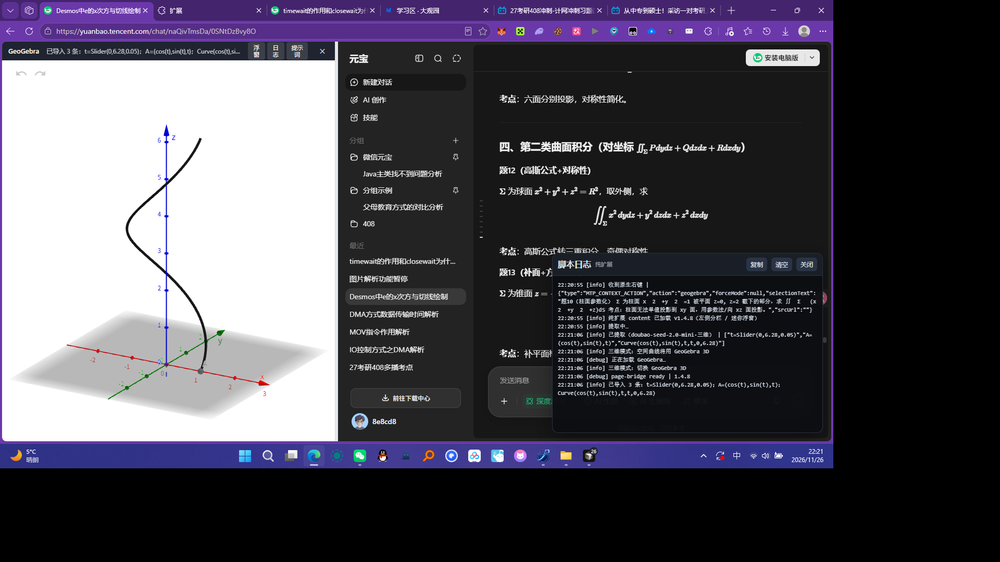
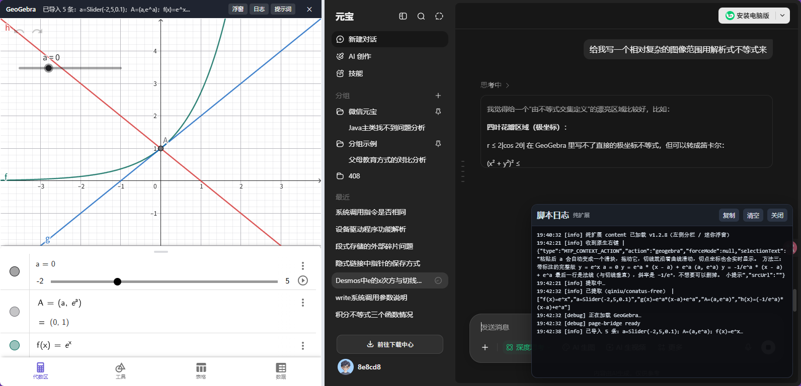
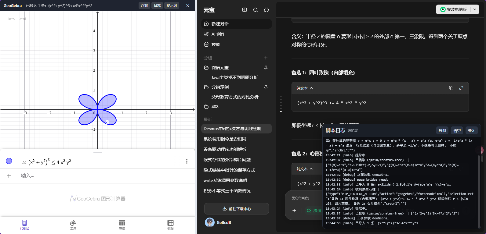
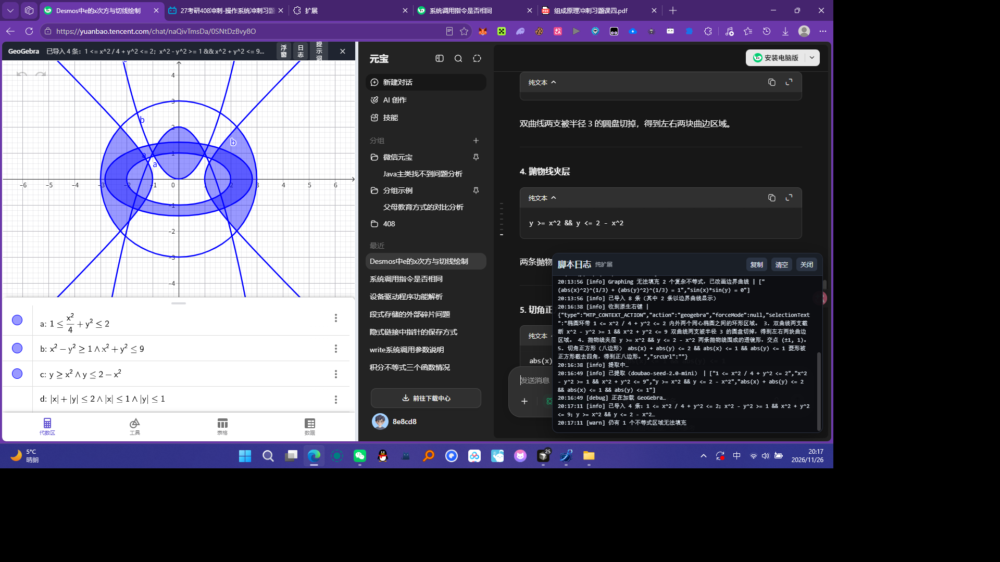
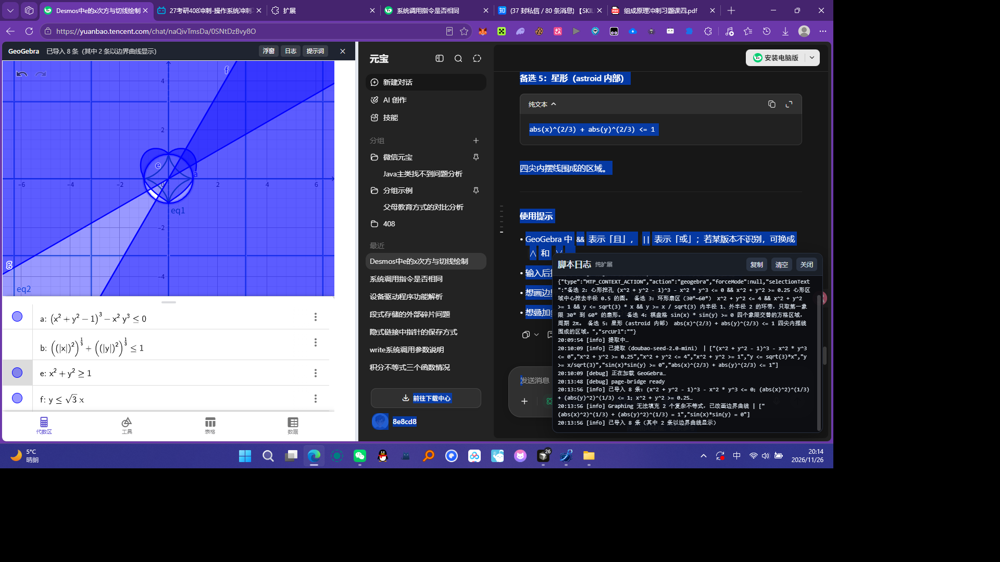
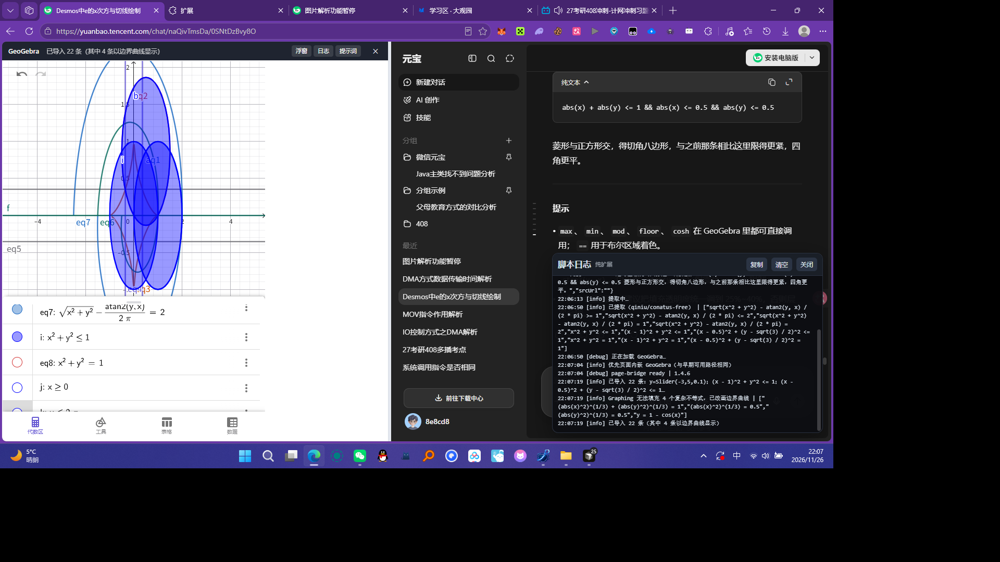

# 选中公式 → GeoGebra

Edge / Chrome MV3 扩展：选中网页上的公式或图像，AI 转成 GeoGebra 命令，左侧分栏或迷你浮窗内嵌绘图；CSP 站点自动回退独立窗口。

当前版本 **1.4.9**。

## 演示截图

### 三维螺旋线（自动切 GeoGebra 3D）



### 切线 / 法线滑块（\(e^x\)）



### 四叶玫瑰不等式



### 多重不等式区域



### 复杂区域 + 边界回退





## 安装

见 [安装说明.md](./安装说明.md)。

1. 打开扩展「开发人员模式」→「加载已解压的扩展」→ 选本目录  
2. 在扩展选项中配置 AI API Key  
3. 网页选中公式 → 右键「GeoGebra」

## 能力摘要

| 场景 | 行为 |
| --- | --- |
| 函数 / 滑块 / 切线 | Graphing 内嵌 |
| 不等式区域 | 填充；复杂式改画边界曲线 |
| 线面积分题 | 路径 + 定向 +（可选）场样本 |
| 螺旋线 / 柱面 / 球面 / 空间实体 | 自动 `appName: 3d` |
| 敌对 CSP 页面 | 加载器 → 顶层沙箱窗口 |

题型分流与模板单测：

```bash
node test-scene-classify.mjs
```

命令与 Apps API 速查：[AI-GGB-API.md](./AI-GGB-API.md)
